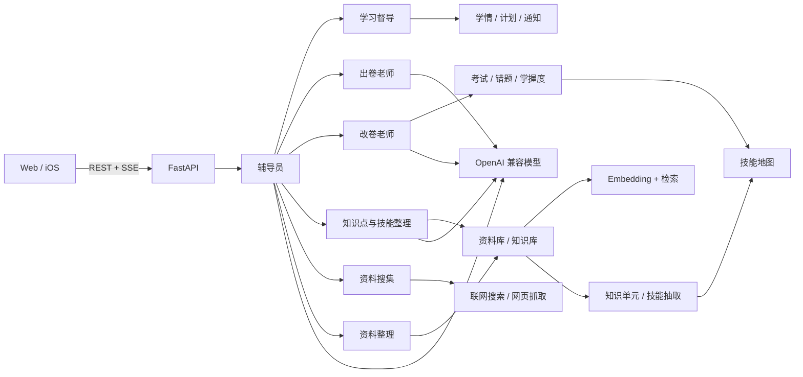

# 考公私塾 · Kaogong School

> 一个本地优先、多智能体协作的个人考公学习系统。  
> 把课程资料、知识整理、技能地图、出卷、改卷和学情计划收进同一个对话框。


它不是一个只会聊天的题库，而是一套围绕「资料 → 知识 → 技能 → 练习 → 反馈」闭环设计的个人备考系统：

- 辅导员统一入口，自动把问题分诊给资料、知识、出卷、改卷、督导等专业老师。
- 上传 PDF、网页、图片、音频或视频，自动解析、分块、打标、向量化，并挖掘知识单元和技能。
- 知识不只是 RAG 片段：会整理「怎么考、怎么识别、标准步骤、易错点、常见变式、出题人怎么设干扰」。
- 技能地图按科目/模块展示掌握状态；做题后直接更新技能级掌握度。
- 出卷、限时作答、自动判分、逐题解析、举一反三、错题本、周计划和周报形成闭环。
- Web 与原生 iOS 共用同一套 API；支持本机、局域网、Tailscale 私有 HTTPS 访问。

---

## 目录

- [核心能力](#核心能力)
- [界面](#界面)
- [快速开始](#快速开始)
- [配置模型](#配置模型)
- [系统架构](#系统架构)
- [iOS 客户端](#ios-客户端)
- [部署](#部署)
- [主要 API](#主要-api)
- [评测](#评测)
- [已知边界](#已知边界)
- [参与贡献](#参与贡献)
- [License](#license)

---

## 核心能力

### 1. 七角色多智能体辅导

| 角色 | 职责 |
|---|---|
| 辅导员 | 学生唯一入口，理解问题并分诊 |
| 资料搜集 | 上传文件、导入网页、联网搜索、读取链接 |
| 资料整理 | 查看入库状态、分块质量、失败原因、重新索引 |
| 知识点与技能整理 | 基于资料库回答，整理知识点、技能、考法和变式 |
| 出卷老师 | 按科目、模块、题量、难度组卷，支持 AI 原创题 |
| 改卷老师 | 解释得分、错题、正确思路、对应技能和举一反三 |
| 学习督导 | 读取真实学情，生成学习计划和复习建议 |

每个角色可以单独配置模型、Base URL、API Key、temperature、max_tokens 和 top_p；留空则继承全局配置。

### 2. 资料理解

- **文档**：PDF、DOCX、TXT、Markdown，按标题层级结构分块。
- **网页**：公网 URL 导入，带 SSRF 防护；支持 DeepSeek Fetch 或本地解析回退。
- **图片**：macOS Vision 中文 OCR，失败时回退 tesseract / DeepSeek OCR。
- **扫描版 PDF**：配置 DeepSeek 官方 Key 后自动逐页 OCR。
- **音频 / 视频**：字幕优先，其次本地 `faster-whisper` 或 OpenAI 兼容 ASR。
- **视频课件**：抽帧 → OCR → 合并相似画面 → 对齐讲解 → 逐页总结，保留时间戳和关键帧。

### 3. 知识挖掘与技能地图

资料入库后自动抽取知识单元和可复用技能，并继续整理：

- 怎么考
- 题目识别信号
- 标准步骤
- 易错点
- 常见变式
- 出题人怎么设干扰
- 关联知识点 / 易混点

同一知识点下的技能会聚合；如果发现知识树没有覆盖的新考点，会进入「新知识点候选」，审核后可一键挂到父级知识点下。

技能地图按科目/模块展示：

`熟练 · 会用 · 了解 · 不清楚 · 待复习`

技能级掌握度优先来自真实作答；没有技能数据时回退到知识点估算，并明确标注「知识点估算」。

### 4. 出卷、改卷与学情闭环

- 按科目/模块/难度/题量组卷，30 题默认 28 单选 + 2 简答。
- AI 原创题可指定数量；生成失败自动回退题库。
- 限时作答、答题卡、自动保存、时间到自动交卷。
- 客观题自动判分；主观题按评分细则踩点，真实 LLM 可用时由 grader 模型评分。
- 报告包含逐题解析、评分细则命中、对应技能、技能掌握度变化和举一反三。
- 学情看板包含模块雷达、正确率趋势、知识点热力图、薄弱点、覆盖度和模型用量。
- 周计划、每日任务、周报和主动提醒全部基于真实作答数据。

### 5. 本地优先与多端

- 默认 SQLite，无需额外数据库；可选 PostgreSQL / pgvector。
- OCR、分块、检索、计划、周报都在本地完成。
- Web（PWA 安装壳）与原生 SwiftUI iOS 客户端。
- 局域网扫码连接、Tailscale 私有 HTTPS、launchd 开机自启。

### 6. 模型自由

兼容任意 OpenAI 兼容服务：OpenDesign / AMR、OpenAI、DeepSeek、硅基流动、Moonshot、智谱 GLM、通义千问、OpenRouter、Ollama、LM Studio 等。

- 自动发现 `/models` 模型列表。
- 全局默认 + 按角色覆盖。
- Embedding 和 ASR 可独立配置端点与 Key。
- 没有 Key 也能用本地演示模式走完资料、出卷、判分和学情流程。

---

## 界面

| 模块 | 能力 |
|---|---|
| 对话 | SSE 流式、Markdown、文件上传、历史会话、回答朗读 |
| 资料 | 上传/导入、分块预览、视频关键帧时间轴、检索、知识树 |
| 知识挖掘 | 知识单元/技能审核、深挖详情、新知识点候选、重新抽取 |
| 技能地图 | 科目/模块筛选、掌握状态、考法/步骤/变式、来源资料 |
| 考试 | 组卷、限时作答、答题卡、自动保存、报告、错题 |
| 学情 | 雷达、趋势、热力图、薄弱点、计划、周报、用量成本 |
| 设置 | 连接状态/历史、扫码连接、角色模型、Embedding、ASR、DeepSeek |

---

## 快速开始

### 环境要求

- macOS（图片 OCR / iOS 需要；其余平台可运行后端）
- Python 3.12 + [uv](https://docs.astral.sh/uv/)
- Node.js 20+ 与包管理器
- `ffmpeg`（视频抽帧与音频处理）
- Xcode 16+（仅 iOS 客户端）
- 可选：PostgreSQL、Redis、Tailscale、DeepSeek 官方 Key、Tavily Key

### 启动 Web

```bash
git clone https://github.com/yijiejiang/kaogong-school.git
cd kaogong-school

cp backend/.env.example backend/.env
# 至少修改 APP_SECRET_KEY

make install
make backend    # http://localhost:8000
make frontend   # http://localhost:3000
```

打开 http://localhost:3000，进入「设置」填写模型 Base URL、API Key 和模型名，保存并测试连接。

### 没有 Key 也能体验

```bash
make backend-demo   # MOCK_LLM=1
make frontend
```

演示模式会返回固定的学情、出卷卡片和知识库回答；资料入库默认使用本地 `hash-384` 向量，不需要 Embedding Key。

从演示模式切到真实模型：

```bash
# backend/.env
MOCK_LLM=0
```

然后用 `make backend` 重启。

### 一条视频试试

1. 打开「资料 → 导入网页」。
2. 粘贴 Bilibili / YouTube 课程链接。
3. 等待入库完成。
4. 展开资料，查看逐页摘要、讲解文字和关键帧。

无字幕视频建议安装本地转写：

```bash
cd backend
uv add faster-whisper
# 可选：ASR_LOCAL_MODEL=medium
```

---

## 配置模型

所有配置都可以在网页「设置」里完成，也可以写进 `backend/.env`。

| 配置 | 说明 |
|---|---|
| `APP_SECRET_KEY` | 加密存储 API Key 的密钥，变更后需重新填写 Key |
| `MOCK_LLM` | `1` 为本地演示模式，`0` 为真实模型 |
| `DATABASE_URL` | 默认 SQLite；可切换 PostgreSQL |
| `PUBLIC_BASE_URL` | 二维码使用的公网/私有 HTTPS 地址 |
| `LLM_API_BASE` / `LLM_API_KEY` / `LLM_DEFAULT_MODEL` | 全局模型默认值 |
| `LLM_EMBEDDING_MODEL` | 留空使用 `hash-384`；填写后调用 Embedding API |
| `DEEPSEEK_API_KEY` | 可选，用于官方 Search/Fetch、扫描 PDF OCR、短音频 ASR |
| `TAVILY_API_KEY` | 可选，DeepSeek 搜索不可用时的联网搜索兜底 |
| `ASR_LOCAL_MODEL` | faster-whisper 模型，默认 `small` |
| `ENABLE_KNOWLEDGE_EXTRACTION` | 是否在入库后自动抽取知识单元，默认开启 |

API Key 在数据库中加密存储，接口只返回脱敏值。不要提交 `backend/.env`。

---

## 系统架构



更详细的分层说明见 [docs/architecture.md](docs/architecture.md)。

---

## iOS 客户端

```bash
open ios/KaogongSchool.xcodeproj
```

原生 SwiftUI，最低 iOS 17，包含：

- 对话、Markdown、文件上传、回答朗读
- 学情、考试、答题、批改报告
- 知识 Tab：资料 / 挖掘 / 技能地图
- 视频关键帧、技能级掌握度
- 扫码连接、连接历史、DeepSeek / 模型设置

最简连接方式：

1. Mac 与 iPad/iPhone 在同一 Wi-Fi。
2. `make backend-lan` 启动后端（监听 `0.0.0.0`）。
3. 网页「设置 → 用 iPad / iPhone 扫码连接」，用系统相机或 App 内扫码。

外网访问推荐 Tailscale，见 [deploy/tailscale.md](deploy/tailscale.md)。  
TestFlight 打包见 [deploy/testflight.md](deploy/testflight.md)。

---

## 部署

### 本机常驻

```bash
make install-service    # launchd 开机自启
make service-logs       # 查看日志
make uninstall-service  # 停止并移除
```

### Docker / PostgreSQL

```bash
make infra    # PostgreSQL + Redis
# 修改 DATABASE_URL 为 postgresql+asyncpg://...
```

### Cloud Run

见 [deploy/cloudrun.md](deploy/cloudrun.md)。  
注意：当前上传目录是本地磁盘；公网部署前建议接对象存储，并补充登录鉴权。

---

## 主要 API

| 分类 | 接口 |
|---|---|
| 对话 | `POST /api/chat/stream`、`GET /api/chat/sessions` |
| 资料 | `/api/materials/*`、`POST /api/search` |
| 知识 | `/api/knowledge/tree`、`/units`、`/skills`、`/skill-map` |
| 考试 | `/api/exams/*`、`/api/attempts/*` |
| 学情 | `/api/analytics/*`、`/api/plan/*` |
| 通知 | `/api/notifications/*` |
| 语音 | `/api/asr/status`、`/api/asr/transcribe` |
| 连接 | `/api/connect/info`、`/api/connect/qr.png` |
| 设置 | `/api/settings`、`/api/settings/models`、`/api/settings/test` |

所有按学习者隔离的接口都接受 `user_id` 查询参数；Web 和 iOS 会自动携带当前学习者。

---

## 评测

资料打标与检索评测：

```bash
cd backend
uv run python scripts/evaluate_library.py
```

指标：Top-1 知识点准确率、Top-3 标签召回、chunk 类型准确率、Recall@5。  
评测集在 [backend/evals/library_cases.json](backend/evals/library_cases.json)。

后端测试：

```bash
cd backend
uv run pytest -q
```

iOS 编译：

```bash
xcodebuild -project ios/KaogongSchool.xcodeproj \
  -scheme KaogongSchool -configuration Debug \
  -sdk iphonesimulator \
  -destination 'generic/platform=iOS Simulator' \
  CODE_SIGNING_ALLOWED=NO build
```

---

## 已知边界

- **个人/本地优先**：当前没有登录鉴权，公网部署前必须补认证。
- **视频**：MVP 使用固定间隔抽帧，不含镜头检测、动画合并和视觉模型图表理解；长视频首次入库较慢。
- **字幕**：受平台限流或 Cookie 影响；无字幕时先尝试语音转写，再回退简介。
- **ASR**：本地 `small` 模型对考公术语仍有少量同音错字。
- **技能匹配**：题目到技能目前按知识点 + 文本信号启发式匹配；信号不明显时会回退该知识点下置信度最高的技能。
- **历史数据**：旧作答不会自动回填技能级掌握度；新练习会正常更新。
- **扫描 PDF**：完整 OCR 依赖 DeepSeek 官方 Key；否则只能索引可提取文字的页面。
- **成本**：用量看板按设置页单价估算；单价为 0 时只统计 token。

---

## 参与贡献

欢迎 Issue 和 Pull Request，尤其欢迎：

- 更多题库、评测集和真实课程案例
- 教学法 / 知识图谱 / 技能分类设计
- 视频关键帧与幻灯片识别优化
- iOS / Web 交互与可访问性
- 部署、认证、对象存储和多设备同步

提交前请：

1. 运行 `uv run pytest -q`。
2. 若修改资料/检索逻辑，运行 `uv run python scripts/evaluate_library.py`。
3. 不提交 `backend/.env`、API Key、数据库、上传资料或构建产物。

---

## License

仓库目前尚未附带开源许可证。正式开源前请补充 `LICENSE`（例如 MIT 或 Apache-2.0），再接受外部代码贡献。

---

<p align="center">
  <sub>Built for one person's exam prep, designed like a small school.</sub>
</p>
