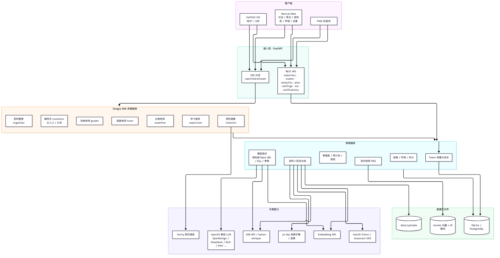
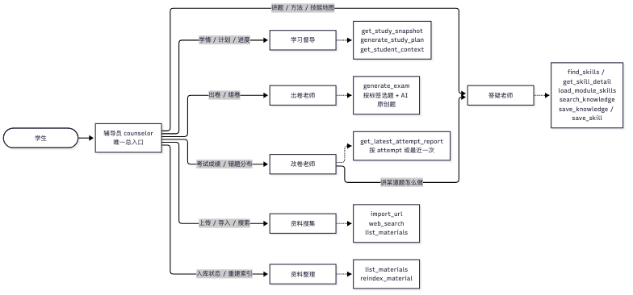
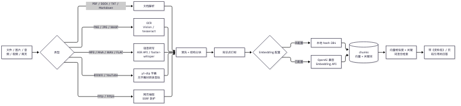
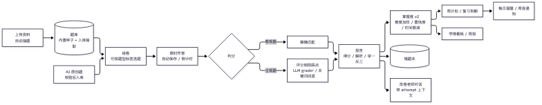
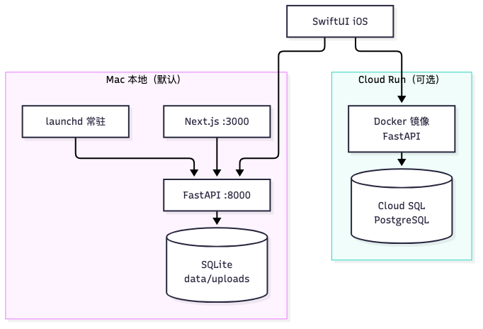

# 考公私塾 · 架构图

> 基于当前仓库实现整理。源图在 `docs/diagrams/*.mmd`，可重新渲染为 SVG / PNG。

## 1. 系统总览



分层说明：

- **客户端**：Next.js Web 是主要入口；SwiftUI iOS 复用同一套 REST + SSE；PWA 提供安装壳。
- **接入层**：FastAPI 同时承担 SSE 对话流和 REST 业务接口。
- **多智能体**：Google ADK 运行时，辅导员是唯一总入口，按问题转接给六位专业老师。
- **领域服务**：资料入库、混合检索、组卷判分、学情计划、用量成本、模型网关。
- **数据层**：SQLite/PostgreSQL 存业务数据；`data/uploads` 存原始文件；`chunks` 存向量与关键词索引。
- **外部能力**：OpenAI 兼容 LLM、Embedding、ASR、Tavily、yt-dlp、OCR。所有模型都走角色级配置的模型网关。

## 2. 多智能体协作



辅导员每轮都从根节点开始分诊，不依赖上一轮最后由谁回答。

| 角色 | 职责 | 主要工具 |
| --- | --- | --- |
| 辅导员 counselor | 总入口、答疑、分诊、陪伴 | `get_student_context`、`get_study_snapshot` |
| 学习督导 supervisor | 学情、掌握度、计划、进度 | `get_study_snapshot`、`generate_study_plan` |
| 出卷老师 examiner | 组卷、AI 原创题、模拟考试 | `generate_exam` |
| 改卷老师 grader | 成绩解读、错题分布、水平变化 | `get_latest_attempt_report` |
| 资料搜集 collector | 上传、网页导入、网页搜索 | `import_url`、`web_search`、`list_materials` |
| 资料整理 organizer | 入库状态、分块质量、重建索引 | `list_materials`、`reindex_material` |
| 答疑老师 tutor | 讲单题、讲方法、查技能地图、保存知识 | `find_skills`、`get_skill_detail`、`load_module_skills`、`search_knowledge` |

## 3. 资料入库与 RAG



要点：

- 文档、图片 OCR、音频/视频转写、网页抽取统一进入同一条分块与打标流水线。
- 未配置 Embedding 时使用本地 `hash-384` 向量，保证没有 Key 也能完整演示；配置后走 OpenAI 兼容 Embedding API。
- 检索分数 = 向量相似度 + 中文关键词命中；回答必须带《资料名》和页码引用。
- 网页导入有 SSRF 防护；视频优先字幕，缺失时尝试 ASR，再回退简介。

## 4. 考试与学情闭环



- **组卷**：从题库选题（内置 89+ 道种子题，上传的资料里带题目会自动抽进题库），可按细粒度标签筛选；可加入 AI 原创题，失败自动回退题库。
- **判分**：客观题精确匹配；主观题按评分细则踩点，真实 LLM 可用时调用 grader，失败回退关键词。
- **报告**：总分、逐题解析、评分细则命中、举一反三、知识点掌握度变化。
- **学情**：掌握度 v2 按难度加权、计算置信度、按时间衰减；周计划按薄弱点与复习到期生成。
- **闭环**：报告 → 错题本 / 掌握度 → 周计划 / 看板 / 通知 → 改卷老师对话。

## 5. 部署形态



- **Mac 本地（默认）**：Next.js + FastAPI + SQLite；`make install-service` 用 launchd 常驻。
- **Cloud Run（可选）**：后端 Docker 镜像 + Cloud SQL PostgreSQL；见 `deploy/cloudrun.md`。
- **iOS**：模拟器连 `127.0.0.1:8000`；真机连 Mac 局域网 IP，后端用 `make backend-lan` 启动。

## 6. 核心数据表

| 领域 | 表 |
| --- | --- |
| 资料与索引 | `materials`、`chunks`、`jobs` |
| 知识体系 | `knowledge_points`、`knowledge_cards` |
| 题库与考试 | `questions`、`exams`、`exam_questions`、`attempts`、`answers` |
| 学情 | `mastery`、`error_book`、`plans`、`plan_tasks` |
| 系统 | `app_settings`、`notifications`、`llm_usage` |

## 7. 关键设计取舍

1. **单对话框 + 辅导员分诊**：学生不需要记住每个 Agent 的入口，降低使用成本。
2. **根节点优先**：每轮从 counselor 开始，避免 ADK 默认回到上一个专业 Agent。
3. **本地优先**：SQLite、本地文件、本地哈希向量、launchd 常驻，Mac 上开箱即用。
4. **可降级**：AI 原创题、LLM 评分、ASR、OCR、网页搜索都有明确的失败回退，不编造结果。
5. **模型可按角色拆分**：不同角色可用不同供应商、端点、Key 与采样参数，支持模型自动发现。
6. **API-first**：Web 与 iOS 共用同一套 REST + SSE，后续移动端不需要另建后端。

## 重新渲染

改了 `docs/diagrams/` 下的 `.mmd` 之后，一定要重新导出图片，否则仓库里的图和源码对不上：

```bash
make diagrams              # 全部重渲染
make diagrams DIAGRAM=agents   # 只渲染其中一张
```

脚本会自动遍历 `docs/diagrams/*.mmd`，同时生成 PNG 和 SVG。首次运行会通过 npx 下载 mermaid-cli。
